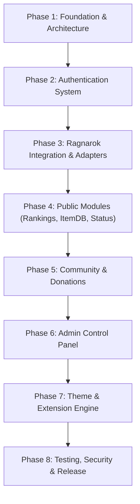

# AetherCP – Master Development Roadmap

## 1. Project Vision & Identity
AetherCP (Aether Control Panel) is an independent, next-generation web control panel for Ragnarok Online private servers supporting **rAthena** and **Hercules** (both Pre-Renewal and Renewal). Built with modern PHP 8.4+ and Laravel, styled with Tailwind CSS, Alpine.js, and Lucide Icons, AetherCP provides a modular, secure, high-performance platform that replaces legacy control panels like FluxCP and CeresCP without cloning their technical debt.

---

## 2. Architecture Principles
- **Dual Database Architecture**: Complete separation of the AetherCP management database (`aether_cp` or configurable) from the game emulator databases (`ragnarok` / `freynix` login, char, map).
- **Emulator Abstraction Layer**: Zero raw emulator SQL scattered in application controllers. All interactions route through `EmulatorInterface`, `RAthenaAdapter`, and `HerculesAdapter` using dedicated repositories.
- **Pluggable Password Hashing**: Compatibility with rAthena and Hercules hashing configurations (MD5, Bcrypt, SHA256, Plaintext) with auto-detection.
- **Aether Dark Theme System**: Built with modern MMORPG aesthetics—deep navy slate backgrounds, cyan/blue ethereal accents, responsive desktop/tablet/mobile layouts.
- **Modular Plugin/Extension Architecture**: Secure module system with manifest declaration, versioning, routes, and permission guards.

---

## 3. Development Phases

### Phase 1: Foundation & Architecture (Current Phase)
- [x] Inspect existing server setup (rAthena schema in `freynix`, MariaDB 10.11, PHP 8.4, Node 24).
- [x] Initialize Laravel 12 application in `C:\xampp\htdocs\aether`.
- [x] Establish Database Compatibility Specification & Schema Documentation.
- [ ] Configure multi-database connections in `config/database.php` (`aether` default + `ragnarok` game connection).
- [ ] Establish configuration files: `config/aether.php`, `config/emulator.php`, `config/modules.php`.
- [ ] Create core contracts and domain interfaces:
  - `App\Contracts\EmulatorInterface`
  - `App\Contracts\PasswordHasherInterface`
  - `App\Contracts\AccountRepositoryInterface`
  - `App\Contracts\CharacterRepositoryInterface`
  - `App\Contracts\GuildRepositoryInterface`
  - `App\Contracts\RankingRepositoryInterface`
- [ ] Implement Emulator Adapters (`RAthenaAdapter`, `HerculesAdapter`).
- [ ] Setup frontend assets (Tailwind CSS, Alpine.js, Lucide Icons, Vite build).
- [ ] Create base master layouts (`layouts.app`, `layouts.admin`, `components.navbar`, `components.footer`).

### Phase 2: Authentication & Password Adapters
- [ ] Implement `EmulatorPasswordHasher` supporting MD5, Bcrypt, SHA256.
- [ ] User registration synchronized with Ragnarok `login` table & AetherCP user profile.
- [ ] Login/Logout with session management, rate-limiting, and brute-force protection.
- [ ] Account profile management: password changes, pincode management, email updates.
- [ ] Account status & security center.

### Phase 3: Ragnarok Integration & Adapters
- [ ] Dedicated repositories implementation:
  - `AccountRepository`
  - `CharacterRepository`
  - `GuildRepository`
  - `RankingRepository`
  - `ItemRepository`
- [ ] Support Pre-Renewal & Renewal field differences (trait stats, 4th job IDs, max level caps).
- [ ] Automated emulator database connectivity verification & unit tests.

### Phase 4: Public Modules
- [ ] Server Information & Live Status (Login, Char, Map status ping, online player counter).
- [ ] Dynamic Rankings (Base Lv, Job Lv, Zeny, MVP kills, Guild WoE/PvP) with configurable caching.
- [ ] Character profile viewer (with privacy controls & hidden GM accounts).
- [ ] Guild directory, member rosters, and Guild Emblem renderer (raw BMP to PNG conversion).
- [ ] Item Database Search with item descriptions, equip locations, and script parsing.

### Phase 5: Community & Donation System
- [ ] News & Announcements CMS (Markdown / Rich content, categories, pinned posts).
- [ ] Server Downloads Management (Mirrors, patch notes, client downloads).
- [ ] Events Calendar & Server Information pages.
- [ ] Donation Packages & Points System (manual receipt verification, credit logs).

### Phase 6: Administration Control Panel
- [ ] Admin Dashboard with real-time server metrics and player registration graphs.
- [ ] Account & Character Manager (ban/unban, GM level assignment, character reset/unstuck).
- [ ] Content Manager (News, Downloads, Announcements).
- [ ] Donation management and manual approvals.
- [ ] System audit logs & security logs.

### Phase 7: Themes & Module Engine
- [ ] Theme manager with theme inheritance and custom asset loading.
- [ ] Modular plugin loader with safe activation/deactivation.
- [ ] Developer API and documentation.

### Phase 8: Testing, Security & Release
- [ ] Security audit (SQL injection, XSS, CSRF, mass assignment).
- [ ] Emulator compatibility matrix validation (rAthena vs Hercules).
- [ ] End-to-end automated test suite.
- [ ] Installation Wizard and CLI setup command (`php artisan aether:install`).
